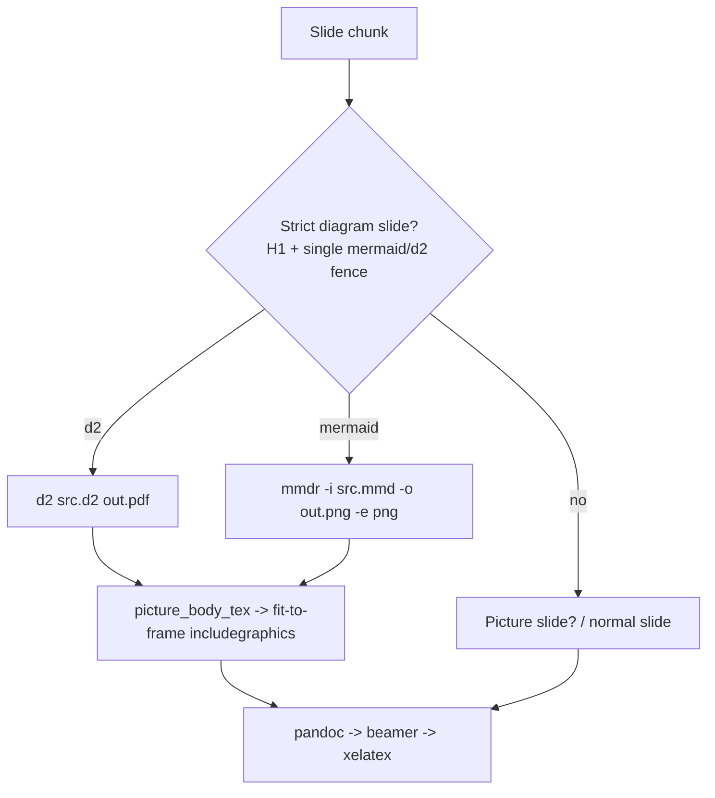

# Spec: Mermaid & D2 diagram slides for md2pdf

Status: proposed
Date: 2026-10-09
Tool: `tools/md2pdf/md2pdf.py`

## Problem statement

Deck authors (humans or agents) should be able to write ` ```mermaid ` or ` ```d2 ` fenced code blocks as slide bodies in the Markdown original and have md2pdf render them to images at build time and place them fit-to-frame on the slide, with no manual pre-rendering. This extends the existing picture-slide feature from static images to generated diagrams.

## Requirements

- **Strict declaration (mirrors picture slides).** A slide qualifies as a diagram slide only when it is exactly one `# Title` heading plus exactly one fenced ` ```mermaid ` or ` ```d2 ` block, with no other non-blank content. Anything else (extra prose, a bullet, a second fence, a non-diagram fence) makes it render as a normal slide. There is no caption (diagrams carry no alt text).
- **Intermediate image format.** d2 renders to **PDF** (vector). Mermaid renders to **PNG** via `mmdr` (the pure-Rust renderer has no PDF output); it is rendered at high resolution to stay crisp at full-slide width. Both are embedded with the existing fit-to-frame `\includegraphics` layout (`width=\textwidth,height=0.78\textheight,keepaspectratio`).
- **Fail loudly on missing tooling or render error.** If a deck uses a diagram block and the required CLI is missing, or rendering exits non-zero, the build aborts with a clear, actionable error that names the tool and the offending slide. This matches the tool's existing "fail loudly on missing front-matter" philosophy.
- **Renderers.** Mermaid via `mmdr`; d2 via the `d2` CLI. `mmdc` (mermaid-cli) is intentionally **not** used because it depends on a headless Chrome that is not provisioned on the build box.
- **Visual consistency (per critique P2).** Diagrams render with an opaque **white** background to match the Beamer frame body, and with each renderer's default theme (`d2 --theme 0`, `mmdr -t default`). Deeper HIVE brand theming of diagram internals is out of scope for the MVP.
- **No captions in MVP (per critique P3).** Diagram slides carry no caption. A future enhancement could parse an optional caption from the fence info string (e.g. ` ```mermaid "Figure 1" `); this is explicitly deferred, not designed in now.
- **Success criteria (per critique P6).** Rendering adds roughly < 250 ms per diagram slide on standard developer hardware (d2 renders in ~40 ms; `mmdr` similar). Mermaid PNGs render at `-w 2400` so text stays legible at full slide width (1920×1080-equivalent projection). A diagram slide must be visually indistinguishable in chrome (title band, footer) from a picture slide.

## Toolchain findings (build box, 2026-10-09)

- `d2` v0.8.1 (`~/go/bin/d2.exe`): `d2 input.d2 output.pdf` produces a vector PDF in ~40 ms with no browser. Verified (25 KB PDF from a trivial graph).
- `mmdr` v0.3.1 (`~/.cargo/bin/mmdr.exe`): `mmdr -i in.mmd -o out.png -e png` produces a PNG. Verified (rendered an A→B→C flowchart). Supports `-t` theme, `-w`/`-H` raster size, `--preferredAspectRatio`. No PDF or embeddable-SVG output.
- `mmdc` (mermaid-cli) is installed but non-functional here: it uses Puppeteer and fails with `Could not find Chrome`. Avoided by using `mmdr`.
- xelatex + `graphicx` (already loaded in the generated preamble) embeds both PDF and PNG via `\includegraphics`. The existing `picture_body_tex` fit-to-frame layout is reused unchanged for diagrams.

## Existing architecture touchpoints

`tools/md2pdf/md2pdf.py` already: parses front-matter; splits the body into slide chunks on `---` (`split_slides`); detects strict single-image slides (`match_picture_slide`); emits a fit-to-frame frame body (`picture_body_tex`); and rewrites matching slides in `preprocess_body`. Pandoc runs with `cwd=md_path.parent` and `--resource-path md_path.parent`.

Diagram slides slot into the same pipeline: detect a strict diagram slide, render the fenced source to an image file, then reuse `picture_body_tex` pointing at that generated image. Image paths are emitted **relative** to a diagram directory added to pandoc's `--resource-path`, so resolution is unambiguous and robust to paths containing spaces (per critique E10).

**Design rationale: Python preprocessor vs Pandoc Lua filter (per critique P4).** A Lua filter could intercept `CodeBlock` AST nodes directly. We deliberately keep the Python split-and-rewrite approach instead, because it (a) reuses the existing `split_slides` / `match_picture_slide` / `picture_body_tex` machinery and the strict single-element slide model already proven for picture slides, (b) adds no Lua dependency or second language to the tool, and (c) keeps all logic in one maintainable file, `tools/md2pdf/md2pdf.py`.

## Proposed solution

Add a strict diagram-slide detector mirroring `match_picture_slide`, a renderer that shells out to `d2`/`mmdr` writing into a diagram directory (build-scoped temp dir normally, or a persistent `<output-stem>_diagrams` directory when `--keep-tex` is set — see Task 3), and wire both into the slide loop. Detected diagram slides are rendered to an image (PDF for d2, high-resolution PNG for mermaid), and `picture_body_tex` emits the fit-to-frame centred `\includegraphics` pointing at the generated file. A missing CLI or non-zero exit aborts the build with a clear message naming the tool and the slide.



## Task breakdown

### Task 1: Strict diagram-slide detection (test-first)

Add `match_diagram_slide(chunk) -> dict | None` returning `{"title", "lang", "source"}` when a chunk is exactly `# Title` plus one fenced ` ```mermaid ` or ` ```d2 ` block and nothing else; otherwise `None`. Reuse `split_slides`. Parse fenced blocks by info string, capture the block body verbatim (preserve indentation and newlines), and reject on extra content, a second fence, or an unknown language. Keep heading parsing consistent with `match_picture_slide`.

Fence parsing rules (per critique P5): strip trailing whitespace from the info string, and accept only an exact, lone language token — `mermaid` or `d2`. Reject info strings carrying extra parameters (e.g. ` ```d2 layout=elk `) for the MVP; such slides fall through to normal rendering. Blank lines surrounding the fence inside the chunk are ignored.

Diagnostic (per critique P1): detection stays silent here, but `preprocess_body` (Task 3) is responsible for warning when a slide contains a mermaid/d2 fence yet fails strict detection — see Task 3.

Tests: strict mermaid slide → dict with `lang="mermaid"` and exact source; strict d2 slide → `lang="d2"`; fence plus trailing bullet or prose → `None`; two fences → `None`; non-diagram fence (e.g. ` ```python `) → `None`; a picture slide → `None` (detectors stay disjoint); info string with trailing whitespace → still matches; info string with extra parameters → `None`.

### Task 2: Diagram renderer with loud failure (test-first where possible)

Add `render_diagram(lang, source, out_dir, slide_title) -> Path` that writes the source to a temp file in `out_dir` and invokes the correct CLI, returning the generated image path.

- **Filename convention (per critique E6):** namespace the cache key by language and content hash — `out_dir / f"diagram_{lang}_{hashlib.sha256(source.encode('utf-8')).hexdigest()[:16]}.{ext}"` (`.pdf` for d2, `.png` for mermaid). If the file already exists, return it immediately (idempotent, avoids re-rendering).
- **Commands (per critique E2, E5, white background):**
  - d2: `["d2", "--theme", "0", "--browser", "0", str(src_file), str(out_file)]` — local-only (no browser popup), classic theme, vector PDF.
  - mermaid: `["mmdr", "-i", str(src_file), "-o", str(out_file), "-e", "png", "-w", "2400", "-t", "default", "-b", "white"]` — `-w 2400` rasterises at high resolution while preserving the diagram's intrinsic aspect ratio (do **not** also pass `-H`, which would distort); white background to match the slide.
- **Subprocess invocation (per critique E3, E4):** `subprocess.run(cmd, capture_output=True, timeout=30, stdin=subprocess.DEVNULL)`. Catch `subprocess.TimeoutExpired` and raise `SystemExit` naming the slide title, language, and the timeout. On `returncode != 0`, decode stderr with `encoding="utf-8", errors="replace"` and raise `SystemExit` naming the tool, the slide title, and the captured diagnostic. Use argument lists, never shell string interpolation.
- **Binary resolution (per critique E9):** resolve each CLI via `shutil.which` first, then fall back to known locations (`Path.home()/".cargo"/"bin"/"mmdr.exe"` for mermaid, `Path.home()/"go"/"bin"/"d2.exe"` for d2). If still unresolved, raise `SystemExit` with an actionable install hint (`cargo install mmdr`, `go install oss.terrastruct.com/d2@latest`) and the slide title.

Tests (per critique E7, E8):
- Unit (no CLI needed): mock `subprocess.run` to assert correct command formation per language (flags, filenames); assert `TimeoutExpired` → `SystemExit` naming the timeout; assert a non-zero return with stderr bytes → `SystemExit` carrying the decoded diagnostic, tool, and slide title; assert a missing binary → `SystemExit` with the install hint.
- Integration (skipif the respective CLI absent): render a trivial valid d2 → non-empty `.pdf` and a trivial valid mermaid → non-empty `.png`; render invalid d2/mermaid syntax and assert `SystemExit` containing the slide title, tool name, and captured stderr.

### Task 3: Wire diagram slides into `preprocess_body` and `build()`

Thread a dedicated diagram output directory through the rewrite step, e.g. `preprocess_body(body, diagram_dir)`. In the slide loop, after the picture check, test `match_diagram_slide`; for matches, call `render_diagram(lang, source, diagram_dir, title)` and emit the frame via `picture_body_tex` (empty caption) pointing at the generated image. Keep picture and normal slides unchanged.

**Asset lifecycle (per critique E1).** The directory must outlive pandoc/xelatex, and must survive the process when `--keep-tex` is set:
- When `keep_tex` is False, `diagram_dir` is created inside the build's `TemporaryDirectory()` (cleaned up with the build).
- When `keep_tex` is True, `diagram_dir` is a persistent directory alongside the output (e.g. `output.parent / f"{output.stem}_diagrams"`), so the kept `.tex` retains valid references to every rendered diagram asset.

**Path handling (per critique E10).** Add `diagram_dir` to pandoc's `--resource-path` and emit **relative** image filenames in the generated LaTeX, so paths containing spaces (e.g. a temp dir under `C:\Users\John Doe\...`) do not break `\includegraphics`.

**Disqualified-slide diagnostic (per critique P1).** In `preprocess_body`, if a slide chunk contains a ` ```mermaid ` or ` ```d2 ` fence but `match_diagram_slide` returns `None` (extra prose, bullets, or multiple blocks), emit a non-fatal warning to `sys.stderr` noting that the slide will render as a verbatim code block rather than an auto-rendered diagram, so authors are not left guessing.

Tests: a `--keep-tex` build test on a temp deck with one d2 slide and one mermaid slide asserting the generated `.tex` contains two fit-to-frame `\includegraphics` blocks pointing at the rendered files, that the referenced image files exist **in the persistent `_diagrams` directory**, and that they remain after the build (skipif CLIs absent). A unit test asserting the disqualified-slide warning is emitted to stderr for a mermaid fence placed alongside a bullet.

### Task 4: Sample deck + end-to-end build verification

Extend `tools/md2pdf/examples/` (new `diagram-demo.md`, or additions to `picture-demo.md`) with one ` ```mermaid ` slide and one ` ```d2 ` slide alongside a regular slide. Add an end-to-end test that builds the deck to a temp PDF, asserting exit 0 and non-empty output, then cleans up artifacts. Render a page to PNG to visually confirm the diagrams appear (as done for the picture slide). The `.pdf` output stays gitignored (`*.pdf`).

Tests: end-to-end build returns 0 and writes a PDF > 0 bytes (skipif CLIs absent); structural `.tex` assertions from Task 3 cover the rendering wiring.

### Task 5: Documentation update

Update the module docstring in `md2pdf.py` and the AGENTS.md md2pdf entry to document diagram slides: a slide that is `# Title` plus one ` ```mermaid ` or ` ```d2 ` fence is rendered to an image and placed fit-to-frame; strict detection; d2 → PDF, mermaid → PNG via `mmdr`; the build fails loudly if the required CLI (`d2`/`mmdr`) is missing. Note that `mmdc` is intentionally not used (avoids a Chrome dependency). Match the concise style of the existing picture-slide docs and include a short example of each fence.

## Deviations from the original choices

- Mermaid renders to **PNG**, not PDF, because `mmdr` has no PDF output. It is rendered at high resolution to stay crisp. d2 remains vector PDF.
- Mermaid uses **`mmdr`** rather than `mmdc` to avoid the missing headless-Chrome dependency on the build box.

## Critique resolution (2026-10-09)

Dual-lens critique in `tooling/critiques/md2pdf-diagram-slides-critique.md` returned **PROCEED WITH UPDATES**. Resolution of each finding:

| ID | Severity | Resolution |
|----|----------|------------|
| E1 | 🎯 | Task 3: persistent `<output-stem>_diagrams` dir when `--keep-tex`; temp dir otherwise. |
| E2 | 🎯 | Task 2: `mmdr -w 2400` (no `-H`) for high-res, aspect-preserving PNG. |
| E3 | 🎯 | Task 2: `subprocess.run(timeout=30, stdin=DEVNULL)`; `TimeoutExpired` → `SystemExit`. |
| P1 | 💡 | Task 1/3: `preprocess_body` warns on stderr when a mermaid/d2 fence fails strict detection. |
| P2 | 💡 | Requirements + Task 2: white background, `d2 --theme 0`, `mmdr -t default`. |
| P3 | 💡 | Requirements: captions explicitly deferred; optional fence-info caption noted as future work. |
| P4 | 💡 | Proposed solution: documented Python-preprocessor rationale over a Lua filter. |
| P5 | 🤔 | Task 1: info-string parsing rules — strip whitespace, exact `mermaid`/`d2` only, reject extra params. |
| P6 | 💡 | Requirements: < 250 ms/diagram target and full-width legibility criterion. |
| E4 | 💡 | Task 2: decode stderr with `utf-8`, `errors="replace"`. |
| E5 | 💡 | Task 2: `d2 --browser 0`; documented offline/local-only rendering. |
| E6 | 💡 | Task 2: filename `diagram_{lang}_{sha256(source)[:16]}.{ext}` (language-namespaced). |
| E7 | 💡 | Task 2: negative tests for invalid d2/mermaid syntax → `SystemExit` with slide/tool/stderr. |
| E8 | 💡 | Task 2: mocked-subprocess unit tests separated from CLI-gated integration tests. |
| E9 | 💡 | Task 2: `shutil.which` with `~/.cargo/bin` and `~/go/bin` fallbacks and install hints. |
| E10 | 💡 | Task 3: relative image paths via `--resource-path` to tolerate spaces in temp paths. |
