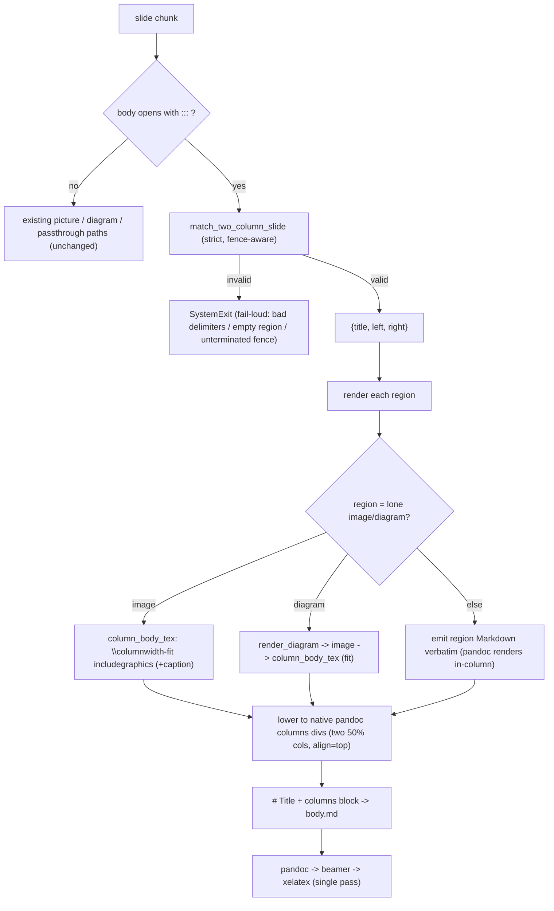

# Full Spec: Two-Column (Picture + Text) Slides

## Problem Statement

md2pdf authors can today produce ordinary slides, strict fit-to-frame **picture**
slides, and strict fit-to-frame **diagram** slides — but there is no way to place
a picture/schema **beside** text on one slide. Authors need a two-column layout
(e.g. image left, bullets right) expressed through a lightweight, md2pdf-owned
convention that does not force them to write raw pandoc div attributes or LaTeX,
and that fails loudly on malformed markup.

## Requirements

Acceptance criteria are user-observable and testable.

**R1 — Authoring convention.** A slide of the form `# Title` followed by a body
that opens with a `:::` delimiter is a *two-column slide*. The body contains
**exactly two regions** delimited by exactly three `:::` lines (opening,
separator, closing). *(Trigger grammar: Q1/Q2.)*

**R2 — Strictly two, 50/50.** The rendered slide has exactly two side-by-side
columns, each `0.5\textwidth`. There is no width syntax and no N-column support.

**R3 — Both sides fit.** A region whose sole non-blank content is one Markdown
image **or** one lone `mermaid`/`d2` fence is scaled to fit its column
(`width=\columnwidth`, bounded height, aspect preserved, centred). Any other
region (bullets/prose/table/mixed) renders as normal Markdown flowing within its
`0.5\textwidth` column. An image region's alt text renders as a small caption.

**R4 — Title & alignment.** The leading `# Title` remains the branded Beamer
frame title; the two columns are the frame body; vertical alignment is fixed
`align=top`.

**R5 — Fail-loud.** Malformed two-column markup raises `SystemExit` with an
actionable, slide-identifying message. Failing cases: not exactly three `:::`
delimiter lines; an empty region; a region's lone diagram fence failing to
render; an unterminated inner fence. No lenient warn-and-pass-through for a slide
that opts into the `:::` shape.

**R6 — Backwards compatibility.** Ordinary, strict-picture, and strict-diagram
slides render **identically** to before. The feature is strictly opt-in: a slide
whose body does not open with a `:::` delimiter is untouched.

**R7 — Diagrams in columns.** A `mermaid`/`d2` fence that is a region's sole
content renders via the existing `render_diagram` cache and is placed
fit-to-column (relative filename, resolved through the existing
`--resource-path`/`\graphicspath`).

**R8 — Docs & example.** README gains a "Two-column slides" dialect subsection;
`examples/two-column-demo.md` demonstrates pic-left/text-right and a
diagram-in-column case and builds under the toolchain-guarded examples test.

## Background (codebase internals)

- **`src/md2pdf/slides.py`** — pure, theme-agnostic detection. `split_slides`
  splits on `^-{3,}$`. `match_picture_slide` and `match_diagram_slide` are
  **strict** matchers returning a dict or `None`. `match_diagram_slide` already
  does **fence-aware scanning** (tracks an opening ```` ``` ````/`~~~` fence and
  collects its body verbatim until the matching close) — the two-column parser
  reuses this technique so inner diagram fences are never mistaken for `:::`
  delimiters. Regexes: `_H1_RE`, `_SLIDE_BREAK_RE`, `_FENCE_RE`,
  `_IMAGE_RE`; `_DIAGRAM_LANGS = ("mermaid", "d2")`.
- **`src/md2pdf/engine.py`** — `picture_body_tex(alt, path)` emits a centred,
  fit raw-LaTeX body (`width=\textwidth,height=0.78\textheight,keepaspectratio`
  + optional `captioncolor` caption). `preprocess_body(body, diagram_dir)`
  iterates chunks: a strict picture/diagram slide becomes `# Title\n\n` + a
  ```` ```{=latex} ```` raw block; a diagram chunk renders via `render_diagram`
  and emits the image by **relative** filename; other chunks pass through.
  Chunks re-join with `\n\n---\n\n`. `build(...)` writes `body.md`, injects a
  `\graphicspath` carrying the diagram dir and theme assets, runs
  pandoc→beamer→xelatex once, and preserves diagnostics on failure.
- **`src/md2pdf/diagrams.py`** — `render_diagram(lang, source, out_dir, title)`:
  content-addressed cache; d2→PDF, mermaid→PNG; **fail-loud** `SystemExit` on
  missing CLI / non-zero exit / timeout.
- **`src/md2pdf/latex.py`** — `latex_path` (forward-slash normalise),
  `latex_escape`.
- **Pandoc capability.** Pandoc renders Markdown **inside** `::: columns` /
  `:::: {.column width=…}` fenced divs for Beamer (User's Guide §10.6), with
  `align=top|center|bottom`. Raw `\begin{columns}` does *not* get its inner
  Markdown processed — hence we lower to native divs, not raw LaTeX.

## Proposed Solution

Approach A from the brainstorm: parse the `:::` shorthand in `slides.py`; lower
it to pandoc's native column divs in `engine.py`; reuse `picture_body_tex`
(column-scoped) and `render_diagram` for the fit-to-column case.

### Data flow



### `slides.py` — detection

Add `match_two_column_slide(chunk) -> dict | None` returning
`{"title": str, "left": str, "right": str}` when the chunk is a valid
two-column slide, `None` when the chunk is *not* a two-column slide (body does
not open with a `:::` delimiter), and raising `SystemExit` when the chunk opens
with `:::` but violates the grammar (fail-loud, R5).

Grammar (Q1):
- A **delimiter** is a line matching `^:{3,}\s*$` (`_COLON_FENCE_RE`), scanned
  **outside** any inner ```` ``` ````/`~~~` fence (reuse `match_diagram_slide`'s
  fence tracking so a `:::` inside a code block is content, not a delimiter).
- Exactly one `# Title` (via `_H1_RE`).
- After the title, the first non-blank line must be a delimiter; the body then
  holds **exactly three** delimiter lines: open, separator, close.
- `left` = verbatim lines between open and separator; `right` = verbatim lines
  between separator and close. Each must have ≥1 non-blank line (else fail-loud:
  empty region).
- A second `# Title`, content after the closing delimiter, or an unterminated
  inner fence → fail-loud.

A small helper `classify_region(region) -> ("image", alt, path) | ("diagram",
lang, source) | ("markdown", text)` decides a region's render mode by reusing
`_IMAGE_RE` / the diagram-fence scan (lone image or lone diagram fence as sole
non-blank content → that mode; otherwise `markdown`).

### `engine.py` — lowering

Add `column_body_tex(alt, path) -> str`: identical to `picture_body_tex` but
scoped to the column — `width=\columnwidth,height=0.78\textheight,keepaspectratio`.
(Refactor `picture_body_tex` to share a private `_fit_image_tex(width_expr, alt,
path)` so both stay in lockstep.)

In `preprocess_body`, before the picture/diagram branches, test
`match_two_column_slide`. On a dict, build each region's inner block:
- `image` → a ```` ```{=latex} ```` block from `column_body_tex(alt, path)`.
- `diagram` → `render_diagram(lang, source, diagram_dir, title)` then
  `column_body_tex("", img.name)` in a raw block.
- `markdown` → the region text verbatim (pandoc renders it).

Then emit (Q4, R2, R4), with distinct outer/inner fence lengths per §10.6:

```text
# <title>

:::::: {.columns align=top}
:::: {.column width="50%"}
<left inner block>
::::
:::: {.column width="50%"}
<right inner block>
::::
::::::
```

`diagram_dir` is already a `preprocess_body` parameter, so the diagram-in-column
path needs no new plumbing. No new dependencies; single pandoc pass preserved.

### Interfaces (sketch)

```python
# slides.py
def match_two_column_slide(chunk: str) -> dict | None: ...
def classify_region(region: str) -> tuple: ...  # ("image"|"diagram"|"markdown", ...)

# engine.py
def column_body_tex(alt: str, path: str) -> str: ...
```

## Testing & Risk Strategy

**Critical paths.** (1) detection of a valid two-column slide; (2) each
fail-loud case; (3) the lowered pandoc structure; (4) fit-to-column image and
diagram; (5) backwards-compat for the three existing example decks.

**Test levels.**
- **Unit (`tests/test_slides.py`)** — `match_two_column_slide` returns the
  right `{title,left,right}` for a valid slide; returns `None` when the body
  does not open with `:::`; raises `SystemExit` for each malformed case (wrong
  delimiter count, empty region, unterminated inner fence). `classify_region`
  categorises image / diagram / markdown regions.
- **Pandoc-only TeX generation (`tests/test_engine.py`)** — `preprocess_body`
  emits the expected `{.columns align=top}` + two `{.column width="50%"}`
  structure; an image region yields a `\columnwidth` `\includegraphics`; a
  markdown region passes through; assert the existing example decks' output is
  unchanged. These give structural coverage without a full LaTeX engine.
- **End-to-end (`tests/test_examples_build.py`)** — toolchain-guarded
  (`skipif` on pandoc/xelatex/d2/mmdr) build of `examples/two-column-demo.md` to
  a non-empty PDF.

**Test data.** A small `assets/placeholder.png` already exists for picture
tests; reuse it. Diagram-in-column uses a tiny `d2`/`mermaid` source.

**Edge/failure cases.** `:::` inside an inner code fence (must be content, not a
delimiter); image with a quoted title; absolute Windows image path; region with
only blank lines (empty → fail-loud); four `:::` lines (→ fail-loud); diagram
fence that fails to render (→ fail-loud via `render_diagram`).

**Risks & mitigations.**
- *Colon-nesting mis-parse* → use distinct outer/inner fence lengths exactly per
  §10.6; assert emitted structure in a pandoc-only test.
- *Inner diagram fence confused with `:::` delimiter* → fence-aware scan reused
  from `match_diagram_slide`; explicit test with a `:::` line inside a code
  block.
- *Regression on existing decks* → strict opt-in trigger + regression test on
  the three example decks.
- *Asset paths with spaces* → reuse existing `\graphicspath`/`--resource-path`
  + relative-filename emission; no new path logic.
- *Text overflow in a narrow column* → documented limitation; text flows
  naturally at 50% width (no forced scaling), consistent with the "both sides
  fit" decision for images/diagrams while letting prose reflow.

## Task Outline

1. **Detector** — `match_two_column_slide` + `classify_region` in `slides.py`
   (strict, fence-aware, fail-loud). Depends on: nothing. Outcome: validated
   `{title,left,right}` and per-region classification.
2. **Lowering** — `column_body_tex` + the `preprocess_body` two-column branch in
   `engine.py`; refactor the shared `_fit_image_tex`. Depends on: Task 1.
   Outcome: `# Title` + native pandoc columns emitted; diagrams routed.
3. **Tests** — unit + pandoc-only TeX-generation + toolchain-guarded e2e;
   regression on existing decks. Depends on: Tasks 1–2. Outcome: all acceptance
   criteria and fail-loud cases covered and green.
4. **Docs & example** — README dialect subsection; `examples/two-column-demo.md`
   wired into the examples-build test. Depends on: Tasks 1–2. Outcome: R8 met.

## Resolved Decisions

| Decision | Source | Choice |
|----------|--------|--------|
| Authoring marker is a bespoke `:::` shorthand | Brainstorm Q1(b) | md2pdf owns `:::`; not raw pandoc divs. |
| Strictly two columns, 50/50 | Brainstorm Q2/Q3 | Two `width="50%"`; no width syntax, no N columns. |
| Both sides fit | Brainstorm Q2 | Image/lone-diagram region → `\columnwidth` fit; other regions → Markdown at 50% width (Q3 default-applied). |
| Keep `# Title`, `align=top` | Brainstorm Q4 | Frame title band preserved; `align=top` on the columns block. |
| Fail-loud | Brainstorm Q5 | `SystemExit` on malformed `:::` markup (Q5 default-applied enumerates cases). |
| `:::` grammar = three delimiter lines | Questionnaire Q1 `default-applied` | open / separator / close; fence-aware; other counts fail loud. |
| Trigger = `# Title` + body opening with `:::` | Questionnaire Q2 `default-applied` | Opt-in; all other slides untouched (R6). |
| Fit mechanism per region | Questionnaire Q3 `default-applied` | Lone image/diagram → fit; else Markdown passthrough; alt → caption. |
| Pandoc div nesting | Questionnaire Q4 `default-applied` | `::::::  {.columns align=top}` + two `:::: {.column width="50%"}`, distinct fence lengths. |
| Fail-loud cases/messages | Questionnaire Q5 `default-applied` | Wrong delimiter count, empty region, diagram render failure, unterminated fence; slide-identifying messages. |

### Out of scope (recorded)

N columns, custom width ratios, author-exposed alignment, overlays / absolute
positioning, animation (`\pause`), PPTX output.
