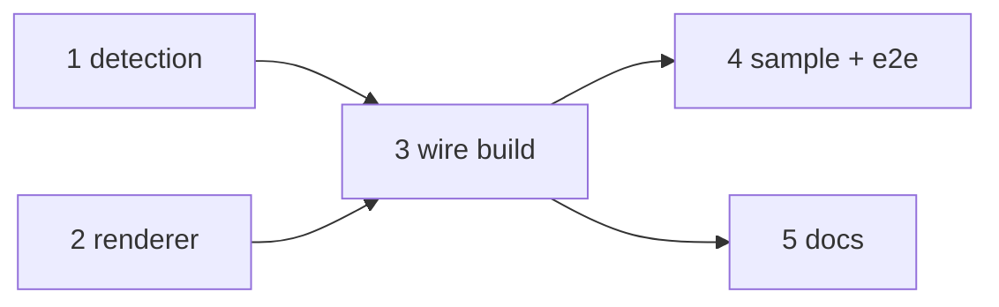

# Task summary: md2pdf diagram slides

Spec: `tooling/specs/md2pdf-diagram-slides.md`
Target: `tools/md2pdf/md2pdf.py` (+ `test_md2pdf.py`, `examples/`, `AGENTS.md`)

## Tasks

| # | Task | File | Depends on |
|---|------|------|------------|
| 1 | Strict diagram-slide detection | `task-1-detection.md` | — |
| 2 | Diagram renderer with loud failure | `task-2-renderer.md` | — |
| 3 | Wire into `preprocess_body` / `build()` | `task-3-wire-build.md` | 1, 2 |
| 4 | Sample deck + end-to-end build | `task-4-sample-and-e2e.md` | 3 |
| 5 | Documentation update | `task-5-docs.md` | 3 |

## Dependency graph

## Parallelization guidance

- **Wave A (parallel):** Task 1 and Task 2 are independent pure-function additions to the same file. They touch different functions (`match_diagram_slide` vs `render_diagram`) and separate test blocks. They can be implemented concurrently, but both edit `md2pdf.py` and `test_md2pdf.py`, so if run by separate agents, serialise the final file writes or assign non-overlapping regions to avoid merge conflicts. For a single implementer, do 1 then 2.
- **Wave B:** Task 3 after both 1 and 2 land (it calls both new functions).
- **Wave C (parallel):** Task 4 and Task 5 after Task 3. Task 4 adds an example + tests; Task 5 edits docstring + AGENTS.md — disjoint files, safe to parallelise.

## Verification gates

- After Wave A: `uv run pytest tools/md2pdf/test_md2pdf.py -k "diagram_slide or render_diagram" -v`.
- After Wave B: `--keep-tex` build test (CLIs present) shows two `\includegraphics` diagram frames.
- After Wave C: full `uv run pytest tools/md2pdf/test_md2pdf.py`; end-to-end diagram-demo build exits 0.

## Toolchain

`d2` (`~/go/bin`), `mmdr` (`~/.cargo/bin`), pandoc 3.10, MiKTeX xelatex. All present on the build box. `mmdc` intentionally unused (no headless Chrome). Run everything via `uv`.
