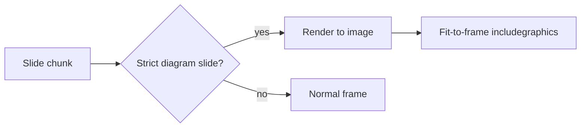

# Regular Slide

- Regular slides keep bullets, tables, and prose as before.
- Diagram slides are detected by convention, with no new syntax.
- A slide counts as a diagram slide only when it is a single heading plus one `mermaid` or `d2` fence.

---

# Mermaid Diagram Slide



---

# D2 Diagram Slide

```d2
Producer -> Broker: publish
Broker -> Consumer: deliver
Consumer -> Broker: ack
```
